# DSO202 Assignment 2 — Report

## 1. Objective

Assignment 1 ran a three-tier Task Tracker (nginx frontend → Node.js API → PostgreSQL)
using only Unit I objects: Deployments, a manually created PVC, ConfigMap/Secret,
ClusterIP/NodePort Services and a namespace with a quota. Assignment 2 deploys the
**same three container images** again and redesigns the platform around them with the
Unit II concepts:

| Descriptor | What was applied to the Task Tracker |
| --- | --- |
| 2.1 StatefulSets (2.1.1–2.1.4) | The database becomes `StatefulSet db` with headless Service `db-svc`, an ordinal identity (`db-0`) and a PVC generated from `volumeClaimTemplates`. |
| 2.2 Ingress (2.2.1–2.2.3) | ingress-nginx controller; one `Ingress` terminates TLS for `tasktracker.local` and routes `/api` → backend, `/` → frontend. No application Service is exposed on a node port any more. |
| 2.3 RBAC (2.3.1–2.3.3) | One ServiceAccount per tier with no API token; a read-only `tasktracker-viewer` and a least-privilege `tasktracker-deployer` (Role + RoleBinding). |
| 2.4 Operators (2.4.1–2.4.3) | A Custom Resource Definition with no controller (to show what a CRD alone does), then the CloudNativePG Operator managing a replicated PostgreSQL cluster with automatic failover. |

A new namespace was used so that Assignment 1 stays untouched as the baseline and the two
designs can be compared.

## 2. Environment

| Item | Version |
| --- | --- |
| Host | macOS 26.7.1, Apple Silicon (arm64) |
| Docker | 29.9.2 (8 CPUs, 8 GB for Docker) |
| kind | v0.32.0 |
| Kubernetes (cluster) | v1.36.1 — 1 control-plane + 2 workers, containerd 2.3.1 |
| kubectl (client) | v1.37.2 (within the supported ±1 minor skew) |
| ingress-nginx | controller-v1.15.1 (kind provider manifest) |
| CloudNativePG | 1.30.1 |
| Application images | `sarojsanyasi/dso202-db:1.0`, `-backend:1.0`, `-frontend:1.0` (unchanged from Assignment 1) |

## 3. Architecture

```
            https://tasktracker.local  (port-forward 8443 -> ingress-nginx :443)
                              |
                 +------------v-------------+   ns: ingress-nginx
                 | ingress-nginx controller |   TLS terminated with Secret tasktracker-tls
                 +-----+---------------+----+
              /api/... |               | /...
     +-----------------v---+     +-----v----------------+   ns: dso202-assignment-02
     | Service backend-svc |     | Service frontend-svc |   (both ClusterIP)
     | Deployment backend  |     | Deployment frontend  |   SA backend-sa / frontend-sa
     |   2 replicas        |     |   2 replicas         |   (no API token mounted)
     +----------+----------+     +----------------------+
                | DB_HOST=db-svc
     +----------v--------------------------+
     | headless Service db-svc (None)      |
     | StatefulSet db -> Pod db-0          |  SA db-sa
     |   DNS db-0.db-svc.dso202-assignment-02.svc.cluster.local
     |   PVC data-db-0 (volumeClaimTemplate, Retain)
     +-------------------------------------+

  RBAC: tasktracker-viewer (read-only) · tasktracker-deployer (create/update/patch, no delete, no secrets)
  ns dso202-operator-lab: CloudNativePG Cluster tasksdb-ha (primary + replica, operator-managed failover)
```

## 4. Procedure and Observations

### 4.0 Baseline — `U2-01-baseline.png`

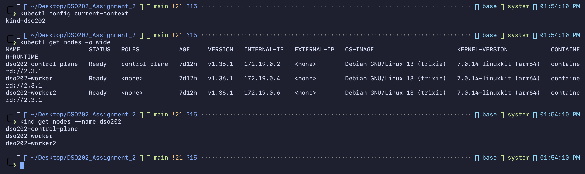
*Figure 1 — U2-01-baseline: Cluster baseline: kind-dso202 context and three Ready nodes*

`kubectl config current-context` returned `kind-dso202`; `kubectl get nodes -o wide`
shows the three kind nodes `Ready` on v1.36.1. This proves the work starts from the same
cluster as Unit I.

The cluster had been stopped since the last practical (`docker ps -a` showed the three node
containers `Exited`), so `kubectl` first returned *connection refused*. Starting the three
containers with `docker start` restored the cluster — the troubleshooting case
"connection refused after a host reboot" from the practical guide.

### 4.1 StatefulSet for the database (2.1)

**Manifest:** `manifests/05-database-statefulset.yaml`.

| Field | Why |
| --- | --- |
| `clusterIP: None` on `db-svc` | Headless: DNS returns the Pod IP and creates `db-0.db-svc…`. |
| `serviceName: db-svc` | Links the StatefulSet to that headless Service. |
| `volumeClaimTemplates: data` | Generates PVC `data-db-0`; no hand-made PVC like Assignment 1's `db-pvc`. |
| `persistentVolumeClaimRetentionPolicy: Retain/Retain` | Deleting or scaling the StatefulSet never deletes the database disk. |
| `podManagementPolicy: OrderedReady`, `partition: 0` | Stated explicitly; `partition` is the canary lever from lecture 2.1.8. |
| `readinessProbe: pg_isready` | `db-0` is only Ready when PostgreSQL accepts connections. |
| `PGDATA=/var/lib/postgresql/data/pgdata` | `initdb` gets an empty sub-directory, never the volume root. |

**Why `replicas: 1`.** The Task Tracker image is one plain PostgreSQL server with no
replication. A StatefulSet gives each replica a stable identity and its own disk, but it
does **not** make PostgreSQL replicate — three replicas would be three diverging databases
(lecture 2.1.9, first pitfall). Multi-instance PostgreSQL is therefore shown in §4.4 with an
Operator, which supplies the replication and failover logic a StatefulSet lacks.

**Deploy — `U2-04-deploy-app.png`.** All objects were created; `rollout status` confirmed
`db`, `backend` and `frontend`; `kubectl get pods -o wide` shows `db-0` (ordinal name)
next to the randomly suffixed Deployment Pods (`backend-64494cd7dc-l7swd`).

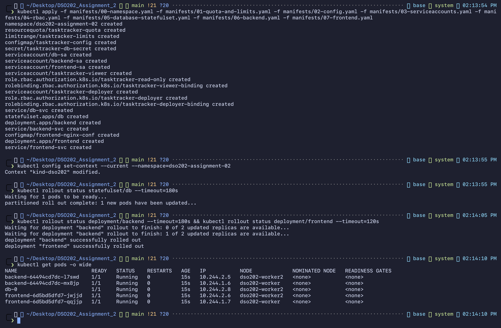
*Figure 2 — U2-04-deploy-app: Deploying namespace, quota, config, RBAC, StatefulSet, backend and frontend*

**Identity — `U2-05-statefulset.png`.**
`kubectl get statefulset,pod,pvc,svc -l tier=database` shows `statefulset.apps/db 1/1`,
`pod/db-0`, `persistentvolumeclaim/data-db-0 Bound 1Gi` and `service/db-svc` with
`CLUSTER-IP None`. The PVC's `selected-node` is `dso202-worker2` and its `OWNER` is
`<none>`: because of `whenDeleted: Retain` the PVC is deliberately not owned by the
StatefulSet. From a backend Pod, `nslookup db-0.db-svc.dso202-assignment-02.svc.cluster.local`
and `nslookup db-svc…` both return `10.244.2.8`, the Pod IP — not a virtual IP.

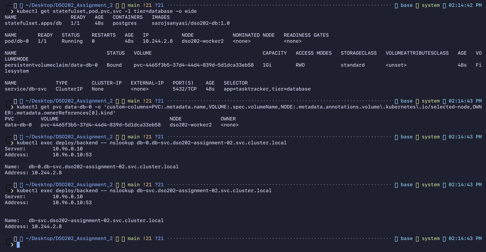
*Figure 3 — U2-05-statefulset: StatefulSet db, Pod db-0, PVC data-db-0, headless db-svc and per-Pod DNS*

**Stable identity across recreation — `U2-06-statefulset-identity.png`.**

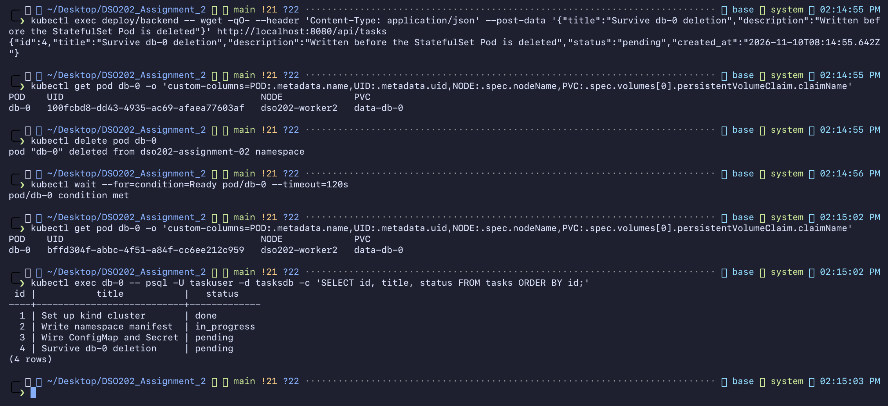
*Figure 4 — U2-06-statefulset-identity: db-0 deleted and recreated: new UID, same name, same PVC, data kept*

1. A task was written through the API: `{"id":4,"title":"Survive db-0 deletion",…}`.
2. Before: `db-0  UID 100fcbd8-…  dso202-worker2  data-db-0`.
3. `kubectl delete pod db-0`, then `kubectl wait --for=condition=Ready pod/db-0`.
4. After: `db-0  UID bffd304f-…  dso202-worker2  data-db-0`.
5. `psql … SELECT … FROM tasks` lists all four rows, including task 4.

The UID changed, so this is a new Pod, but the name, the DNS name and the PVC are the same,
and the data survived. A Deployment Pod would have come back with a new random name. The
Pod also returned to `dso202-worker2` because kind's `local-path` volume lives on that
node's disk (`WaitForFirstConsumer` provisioned it where `db-0` was first scheduled).

**Unplanned finding — `U2-06b-backend-restart.png`.** After `db-0` was deleted both backend
Pods showed `RESTARTS 1`. The previous container exited with `Error exitCode=1`, and its log
shows `Unhandled 'error' event` / `error: terminating connection due to administrator command`
/ `Emitted 'error' event on BoundPool`. When PostgreSQL received SIGTERM it closed the
backend's idle pooled connections; the backend's `pg.Pool` has no `pool.on('error')` handler,
so Node.js crashed. Kubernetes recovered on its own (restart, then `[db] connected`), but the
real fix is one line in the application (`pool.on('error', …)`), which is outside this
assignment because the image is provided.

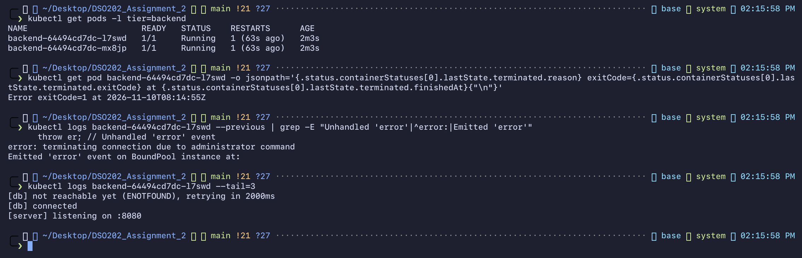
*Figure 5 — U2-06b-backend-restart: Backend restart caused by an unhandled pg pool error*

### 4.2 Ingress and the Ingress controller (2.2)

**Controller — `U2-02-ingress-controller.png`, `U2-03-ingress-diagnose.png`.** The kind
manifest for ingress-nginx v1.15.1 created the namespace, RBAC, admission webhook, the
`nginx` IngressClass and the controller Deployment. `kubectl wait … --timeout=300s` then
**timed out** — see §6 for the diagnosis. After 25 minutes the controller was `1/1 Running`
and `kubectl get ingressclass` shows `nginx  k8s.io/ingress-nginx`.

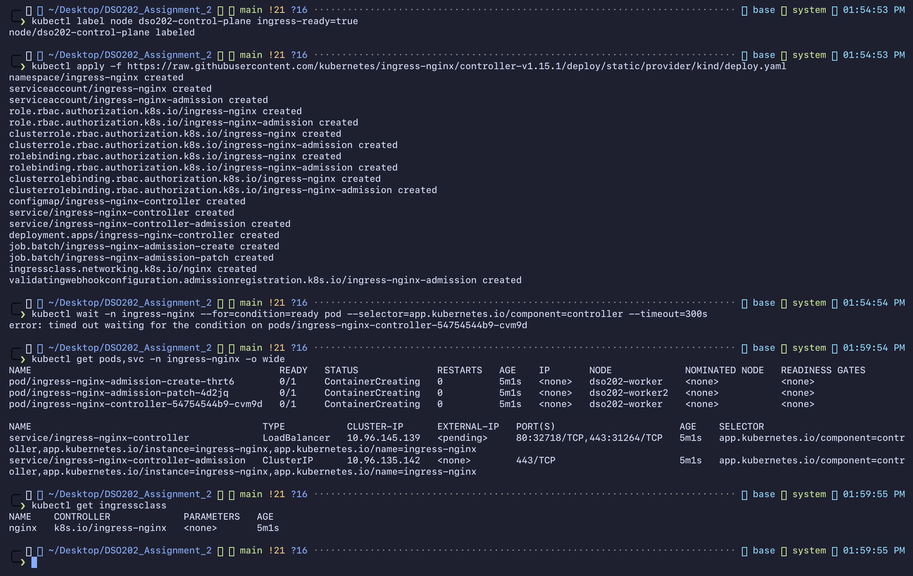
*Figure 6 — U2-02-ingress-controller: Installing the ingress-nginx controller (first wait timed out)*

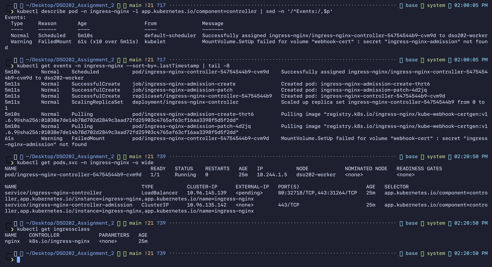
*Figure 7 — U2-03-ingress-diagnose: Diagnosing the stuck controller: missing admission Secret, then controller Running*

**Application changes for Ingress.**

* `frontend-svc` changed from **NodePort 30080 to ClusterIP**. The controller is now the single
  entry point; no application Service needs a node port (lecture 2.2.2). This also removed a
  real conflict: another practical's Helm release (`dso202-dev/webapp-dev`) already holds
  NodePort 30080 on this cluster.
* `BACKEND_URL` changed from `http://backend-svc:8080` (a name a browser cannot resolve) to
  `""`, so the browser calls `/api/...` on the same origin and the Ingress routes it.
* The `/api` proxy block was removed from the frontend's nginx config. Path routing is now
  declared once, in the Ingress, instead of being hidden inside a container.

**Ingress — `U2-11-ingress.png`.** `scripts/make-tls.sh` created a self-signed certificate
(`CN=tasktracker.local`, SAN `DNS:tasktracker.local`) and Secret `tasktracker-tls`; the key
stays in the git-ignored `tls/` directory. `kubectl describe ingress` shows
`tasktracker-tls terminates tasktracker.local` and the rules:

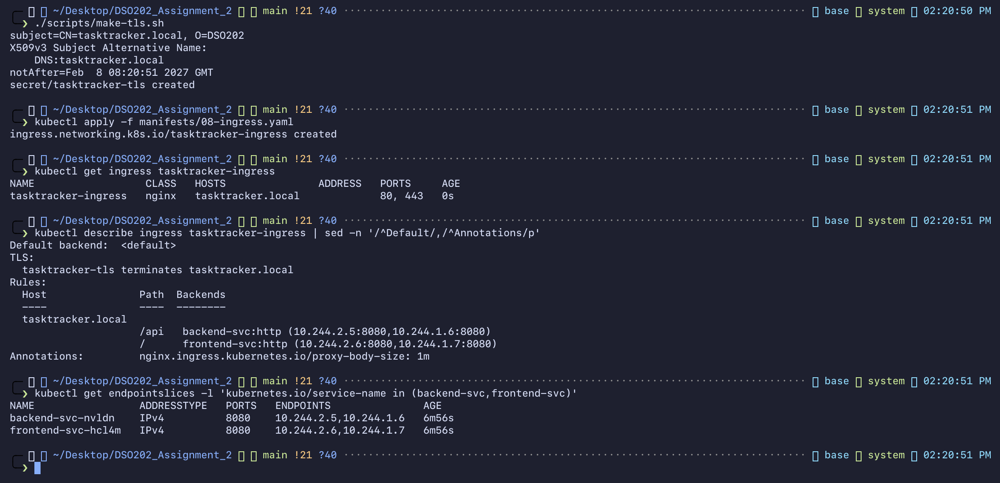
*Figure 8 — U2-11-ingress: TLS Secret and Ingress tasktracker-ingress with resolved backends*

```
tasktracker.local  /api   backend-svc:http  (10.244.2.5:8080,10.244.1.6:8080)
                   /      frontend-svc:http (10.244.2.6:8080,10.244.1.7:8080)
```

Seeing Pod IPs in `Backends` proves the Ingress → Service → EndpointSlice chain is linked.
`ingressClassName: nginx` is used instead of the deprecated annotation, and `pathType: Prefix`
instead of `ImplementationSpecific`, so the rules are portable.

**Traffic — `U2-12-ingress-traffic.png`** (via `kubectl port-forward` to the controller, with
`curl --resolve tasktracker.local:8443:127.0.0.1`):

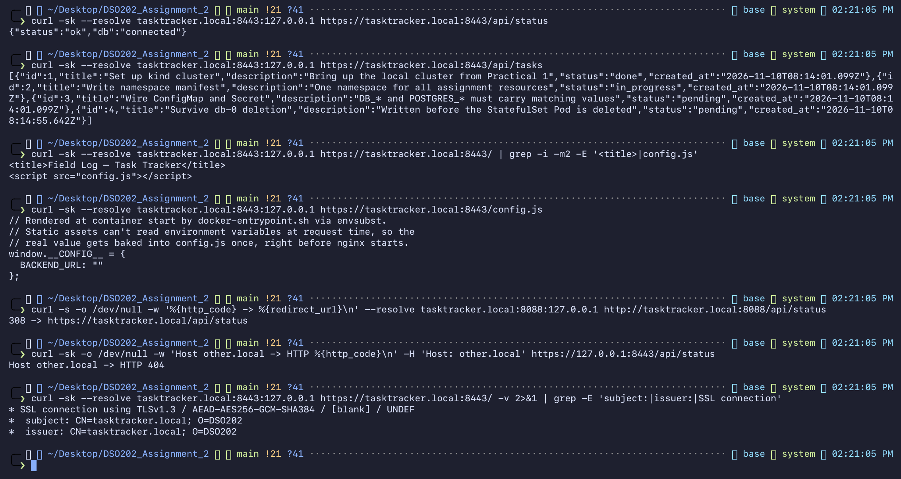
*Figure 9 — U2-12-ingress-traffic: HTTPS traffic through the Ingress: API, frontend, redirect, 404, TLS*

| Request | Result | Shows |
| --- | --- | --- |
| `GET /api/status` | `{"status":"ok","db":"connected"}` | `/api` → backend → db-0 |
| `GET /api/tasks` | 4 tasks incl. "Survive db-0 deletion" | full path, persisted data |
| `GET /` | `<title>Field Log — Task Tracker</title>` | `/` → frontend |
| `GET /config.js` | `BACKEND_URL: ""` | browser uses same-origin `/api` |
| `http://…:8088/api/status` | `308 -> https://tasktracker.local/api/status` | `ssl-redirect` annotation |
| `Host: other.local` | `HTTP 404` | name-based virtual hosting |
| `curl -v` | `TLSv1.3`, `subject: CN=tasktracker.local; O=DSO202` | TLS terminated at controller |

**Production scenario: a 503 that is not the Ingress's fault — `U2-13-ingress-503-diagnosis.png`.**
Reproducing lecture 2.2.8 on the real application:

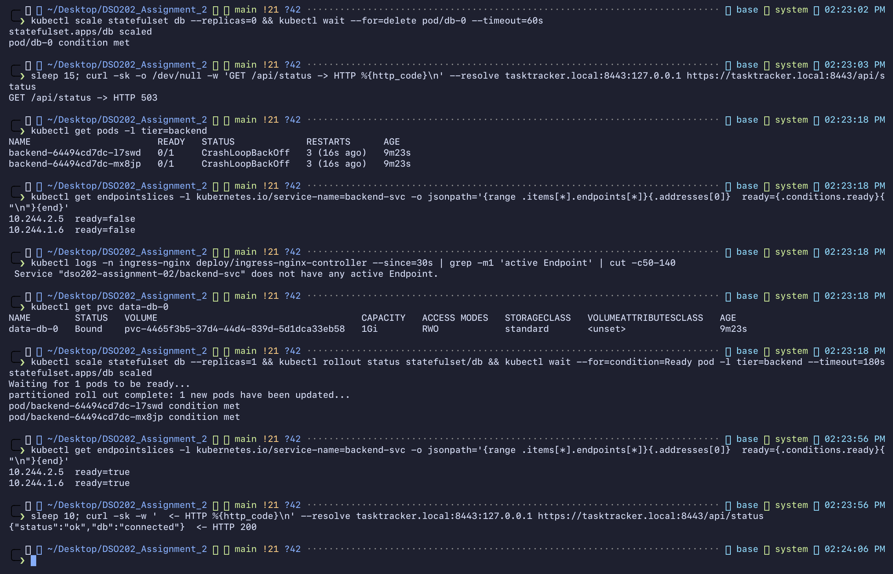
*Figure 10 — U2-13-ingress-503-diagnosis: Database outage: 503, endpoints not ready, PVC retained, recovery to 200*

1. `kubectl scale statefulset db --replicas=0` → `GET /api/status -> HTTP 503`.
2. Backend Pods `0/1` (readiness `/api/status` fails, then the crash from §4.1 puts them in `CrashLoopBackOff`).
3. EndpointSlice: `10.244.2.5 ready=false`, `10.244.1.6 ready=false`.
4. Controller log: `Service "dso202-assignment-02/backend-svc" does not have any active Endpoint.`
5. `kubectl get pvc data-db-0` → still `Bound` (`whenScaled: Retain`): no data lost.
6. Scale back to 1 → endpoints `ready=true` → `{"status":"ok","db":"connected"} <- HTTP 200`.

The Ingress object and controller were never changed. The 503 came from the backend having
no ready endpoints, which is why lecture 2.2.9 warns not to assume a 502/503 originates at the
Ingress layer.

### 4.3 RBAC (2.3)

**Design** (`manifests/03-serviceaccounts.yaml`, `manifests/04-rbac.yaml`):

* `db-sa`, `backend-sa`, `frontend-sa` with `automountServiceAccountToken: false` and no Role.
  None of the tiers calls the Kubernetes API, so none holds a token. In Assignment 1 every Pod
  ran as `default` with a token mounted.
* `tasktracker-viewer` → Role `tasktracker-read-only`: get/list/watch on Pods, logs, Services,
  endpoints, ConfigMaps, PVCs, events, workloads, Ingresses, EndpointSlices. **No Secrets.**
* `tasktracker-deployer` → Role `tasktracker-deployer`: get/list/watch/create/update/**patch**
  on Deployments, StatefulSets, Services, ConfigMaps, Ingresses. **No delete, no Secrets.**
  `patch` is listed because `kubectl apply` sends PATCH for existing objects (lecture 2.3.8).
* Both are namespace-scoped Role + RoleBinding; nothing is cluster-wide.

**Objects — `U2-07-rbac-objects.png`.** Six ServiceAccounts, two Roles, two RoleBindings;
`kubectl describe role tasktracker-deployer` shows the verb list without `delete`.

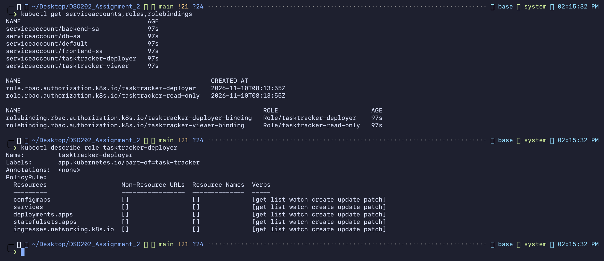
*Figure 11 — U2-07-rbac-objects: ServiceAccounts, Roles and RoleBindings in dso202-assignment-02*

**Authorization matrix — `U2-08-rbac-can-i.png`** (`scripts/rbac-check.sh`, asked of the API server):

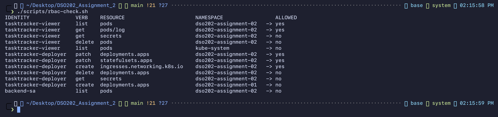
*Figure 12 — U2-08-rbac-can-i: kubectl auth can-i matrix for every identity*

| Identity | Request | Answer |
| --- | --- | --- |
| viewer | list pods / get pods/log (own ns) | yes / yes |
| viewer | get secrets, delete pods (own ns) | no / no |
| viewer | list pods in `kube-system` | no — a RoleBinding only grants inside its namespace |
| deployer | patch deployments, patch statefulsets, create ingresses | yes |
| deployer | delete deployments, get secrets | no |
| deployer | create deployments in `dso202-assignment-01` | no |
| backend-sa | list pods | no |

**Authentication + authorization with a real token — `U2-09-rbac-token.png`.**
`scripts/token-demo.sh` requests a 10-minute token for `tasktracker-viewer` (TokenRequest
API) and uses a throw-away kubeconfig that contains only that token. `kubectl auth whoami`
returns `system:serviceaccount:dso202-assignment-02:tasktracker-viewer` (authentication);
`get pods` succeeds, while `get secrets`, `delete pod db-0 --dry-run=server` and
`get pods -n kube-system` each return `Error from server (Forbidden)` (authorization). A
`Forbidden` means the identity was accepted and RBAC refused the action — the
authentication/authorization split in lecture 2.3.3.

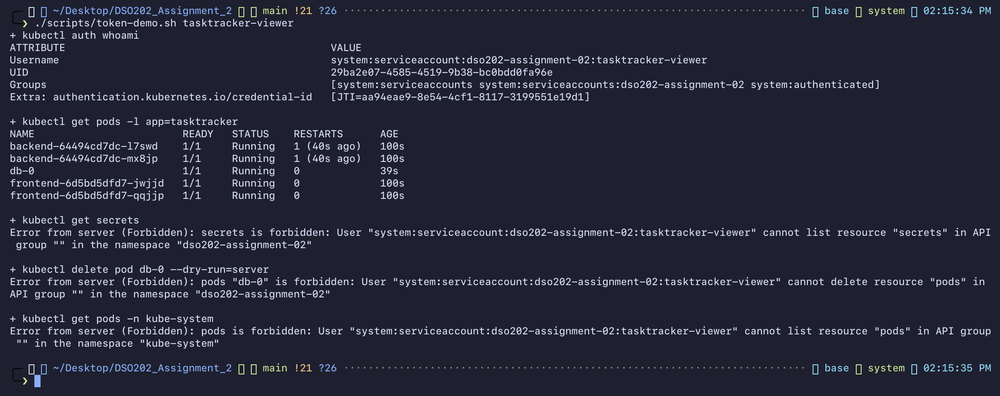
*Figure 13 — U2-09-rbac-token: Real requests with a short-lived tasktracker-viewer token*

### 4.4 CRDs and Operators (2.4)

**A CRD alone — `U2-10-crd-no-operator.png`.** `operator/01-crd-without-controller.yaml`
defines `TaskTrackerDB` (group `dso202.cst.edu.bt`, short name `ttdb`, status subresource,
printer columns, schema limits) and one instance `tasks-ha` with `replicas: 3`.

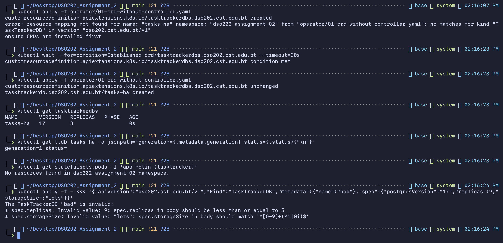
*Figure 14 — U2-10-crd-no-operator: TaskTrackerDB CRD: CR stored, nothing provisioned, schema validation*

* The first `kubectl apply` created the CRD but rejected the CR in the same file:
  `no matches for kind "TaskTrackerDB" … ensure CRDs are installed first`. The API server had
  not finished registering the new type when the CR arrived — the "CR before CRD" pitfall,
  even inside one file. Fix: `kubectl wait --for=condition=Established crd/…`, then re-apply →
  `tasktrackerdb…/tasks-ha created`.
* `kubectl get tasktrackerdbs` → `tasks-ha  17  3` with an **empty PHASE**; `status=` is empty;
  `kubectl get statefulsets,pods` finds nothing new. The object is stored, and nothing happens,
  because no controller watches the type.
* An invalid CR (`replicas: 9`, `storageSize: lots`) is rejected by the OpenAPI schema:
  validation comes from the CRD; behaviour would come from a controller.

**Installing a real Operator — `U2-14-operator-install.png`, `U2-15-operator-not-ready.png`.**
`kubectl apply --server-side -f cnpg-1.30.1.yaml` created 11 CRDs (`clusters.postgresql.cnpg.io`,
`backups…`, `poolers…`, …), the `cnpg-manager` ServiceAccount with its ClusterRole/
ClusterRoleBinding, and the `cnpg-controller-manager` Deployment. Reviewing that RBAC before
applying is the lecture 2.4.6 practice: it is cluster-scoped because the operator must watch
`Cluster` objects in every namespace and create Pods, PVCs, Services and Secrets for them.

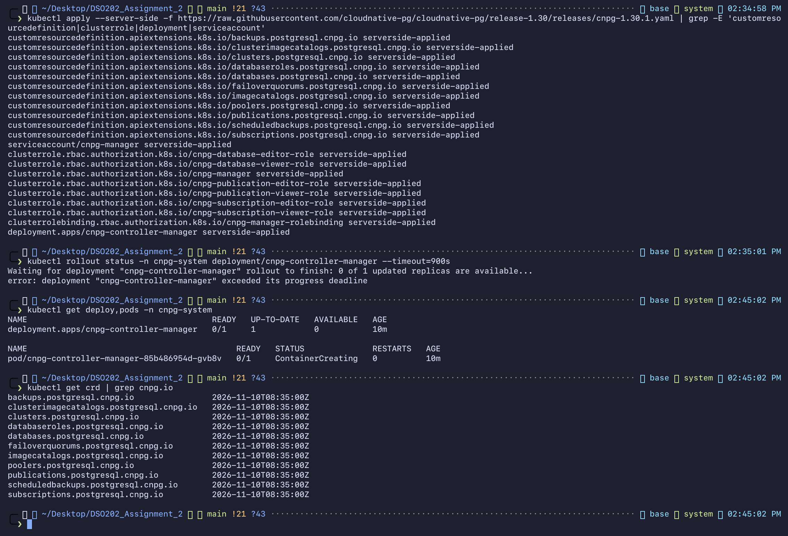
*Figure 15 — U2-14-operator-install: Installing the CloudNativePG operator (CRDs, RBAC, Deployment)*

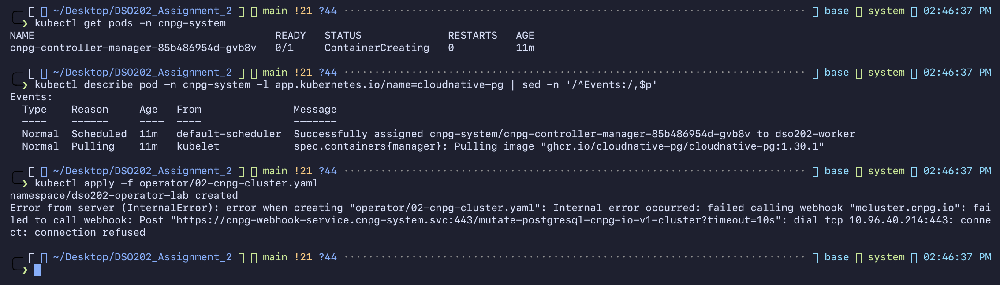
*Figure 16 — U2-15-operator-not-ready: Cluster rejected by the admission webhook while the operator was down*

The rollout exceeded its progress deadline while the operator image downloaded. Applying a
`Cluster` during that window was **rejected**:
`failed calling webhook "mcluster.cnpg.io" … connect: connection refused`. Unlike the plain
`TaskTrackerDB` CRD, CloudNativePG registers mutating/validating admission webhooks served
by the operator itself, so with the controller down the API server cannot accept the object at all.

**The Operator reconciles — `U2-16-operator-cluster.png`, `U2-19-operator-reconciled.png`.**
`operator/02-cnpg-cluster.yaml` is about 20 lines of spec (`instances: 2`, `bootstrap.initdb`,
`storage.size`, resources). From it the operator generated, in 46 seconds:

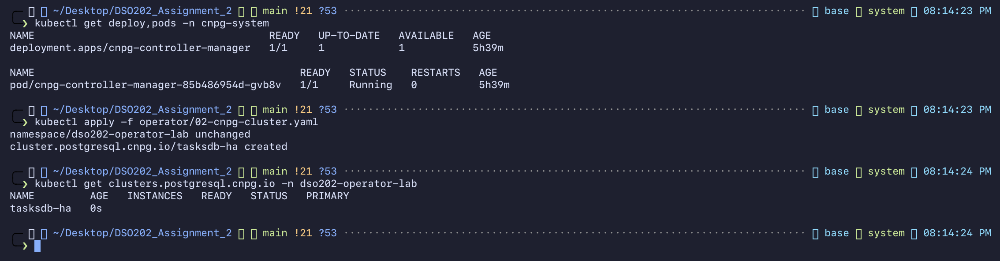
*Figure 17 — U2-16-operator-cluster: Creating Cluster tasksdb-ha once the operator was running*

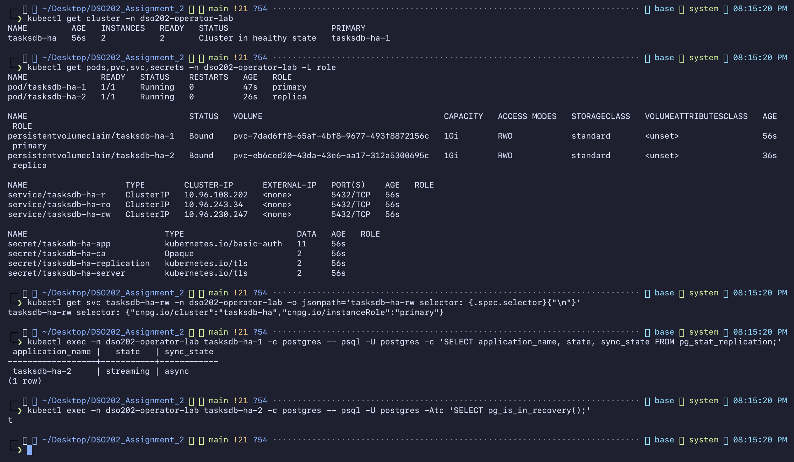
*Figure 18 — U2-19-operator-reconciled: Objects generated by the operator and streaming replication*

| Created by the operator | Purpose |
| --- | --- |
| Pods `tasksdb-ha-1` (`role=primary`), `tasksdb-ha-2` (`role=replica`) | PostgreSQL instances |
| PVCs `tasksdb-ha-1`, `tasksdb-ha-2` | one volume per instance |
| Services `tasksdb-ha-rw`, `-ro`, `-r` | write / read-only / any-instance endpoints |
| Secrets `tasksdb-ha-app`, `-ca`, `-server`, `-replication` | app credentials and TLS for replication |
| PodDisruptionBudget `tasksdb-ha-primary` | protects the primary during node drains |

`tasksdb-ha-rw` selects `cnpg.io/instanceRole: primary`. On the primary,
`pg_stat_replication` shows `tasksdb-ha-2 | streaming | async`, and on the replica
`pg_is_in_recovery()` is `t`. The operator does not use a StatefulSet; it manages Pods and
PVCs directly, which is what lets it choose which ordinal becomes primary.

**Production scenario: automatic failover — `U2-20-operator-failover.png`** (lecture 2.4.8, for real):

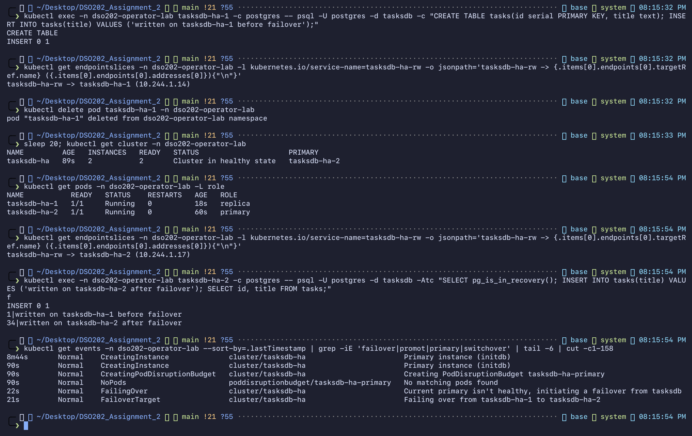
*Figure 19 — U2-20-operator-failover: Automatic failover: tasksdb-ha-2 promoted, -rw Service follows*

1. A row was written on the primary; `tasksdb-ha-rw -> tasksdb-ha-1 (10.244.1.14)`.
2. `kubectl delete pod tasksdb-ha-1` — simulated primary failure.
3. Twenty seconds later: `Cluster in healthy state`, **PRIMARY `tasksdb-ha-2`**.
4. Pods: `tasksdb-ha-2 primary`, and the recreated `tasksdb-ha-1` rejoined as **replica**.
5. `tasksdb-ha-rw -> tasksdb-ha-2 (10.244.1.17)` — the write Service followed the new primary.
6. On `tasksdb-ha-2`: `pg_is_in_recovery() = f`; a new row was accepted, and the row written before
   the failure is still there. (Its id jumps from 1 to 34 because PostgreSQL WAL-logs 32 sequence
   values ahead; a promoted replica starts after them. That is expected, not data loss.)
7. Events emitted by the operator, not by Kubernetes core:
   `FailingOver — Current primary isn't healthy, initiating a failover` and
   `FailoverTarget — Failing over from tasksdb-ha-1 to tasksdb-ha-2`.

No human command promoted the replica, re-pointed the Service or re-attached the old primary.
Compare §4.1: when `db-0` (StatefulSet) was deleted, Kubernetes only recreated the same Pod, and
the application was down until it came back.

**Deviation, stated plainly.** Both instances are pinned to `dso202-worker` with
`affinity.nodeSelector`. The operand image `ghcr.io/cloudnative-pg/postgresql:17` (251 MB) took
over five hours to reach that node (§6, error 5), and it could not be copied to `dso202-worker2`
(below). In production the instances would be spread across nodes/zones. Failover is per Pod, so
the demonstration is unaffected.

### 4.5 Declarative state — `U2-18-final-state.png`

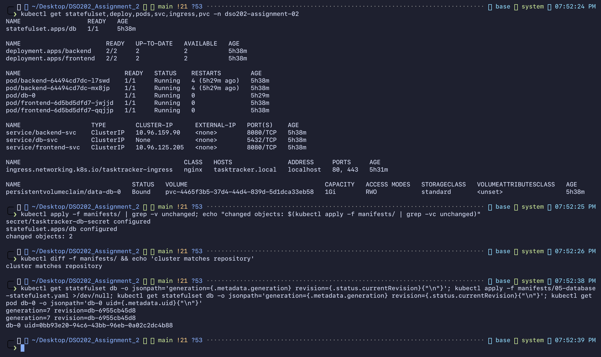
*Figure 20 — U2-18-final-state: Final state and kubectl diff: cluster matches repository*

All application objects are running from the files in `manifests/`.
`kubectl diff -f manifests/ && echo 'cluster matches repository'` prints
`cluster matches repository`. Re-applying reports `secret/tasktracker-db-secret configured` and
`statefulset.apps/db configured` every time, so I checked whether anything actually changes: the
StatefulSet's `generation=7 revision=db-6955cb45d8` is identical before and after apply, and `db-0`
keeps its UID. The message is a client-side three-way-merge artefact (a Secret's `stringData` is
never stored back; `volumeClaimTemplates` gain server-side defaults), not a change.

## 5. Analysis

**Deployment vs StatefulSet.** The backend and frontend stay Deployments: their replicas are
interchangeable and keep no state, so a random name is fine and two replicas give the Ingress
something to balance. The database became a StatefulSet because its identity matters: the
same name, DNS record and disk must come back after every restart (§4.1 proved all three).
A StatefulSet still knows nothing about PostgreSQL, which is why replication and failover were
left to an Operator.

**Ingress object vs Ingress controller.** The Ingress is passive configuration; it did nothing
until the controller was running (§4.2 timeout). The controller watches Ingress, Service and
EndpointSlice objects and turns them into nginx routing. That is why removing ready endpoints
produced a 503 with no Ingress change, and restoring them fixed it with no Ingress change.

**Authentication vs authorization.** The token demo separates them: the API server first turns
the token into `system:serviceaccount:…:tasktracker-viewer`, then RBAC evaluates every binding
for that identity. RBAC is additive with no deny rule, so withholding Secrets means simply
never listing them. Scope comes from the binding type: a RoleBinding confined both identities
to `dso202-assignment-02`.

**CRD vs Operator.** `TaskTrackerDB tasks-ha` and CloudNativePG's `Cluster tasksdb-ha` are
both custom resources. The first produced nothing; the second produced Pods, PVCs, Services,
Secrets and a status, and later a failover. The difference is entirely a running controller
reconciling desired state (spec) into actual state and reporting back in `status`.

## 6. Reflection

**What was difficult.** Getting the images in. On this network `registry.k8s.io` and `ghcr.io`
delivered images at roughly 135 KB/s (`kube-webhook-certgen`, 62 MB, took 7 min 42 s). Every
"wait" step therefore had to be separated from the step that started it, and diagnosed
instead of retried.

**Error 1 — ingress controller stuck in `ContainerCreating` (`U2-03`).**
`kubectl wait` timed out after 300 s. `kubectl describe pod` showed
`MountVolume.SetUp failed for volume "webhook-cert" : secret "ingress-nginx-admission" not found`,
and `kubectl get events` showed the two admission Jobs still `Pulling image … kube-webhook-certgen`.
The reasoning: the controller mounts a Secret, a Job creates that Secret, and the Job's image
had not downloaded. So the failed mount was a symptom of a slow pull, not a misconfiguration,
and the fix was to wait (the Jobs finished, then the controller pulled its own image and became
Ready after 25 min). Nothing was changed in the manifest.

**Error 2 — backend crash when the database restarted (`U2-06b`).** Reading
`kubectl logs --previous` instead of the current log was the key: the current container looked
healthy, while the previous one ended with an unhandled `pg` pool error. Kubernetes self-healed,
but readiness probes plus restarts only hide an application bug; they do not fix it.

**Error 3 — CR rejected in the same apply as its CRD (`U2-10`).** Solved by waiting for the
CRD's `Established` condition. In a GitOps pipeline (Unit IV) CRDs should be applied in an
earlier phase than the resources that use them.

**Error 4 — my own evidence was misleading at first.** `kubectl get endpointslices -o wide`
listed both backend IPs while the backends were not ready, because the ENDPOINTS column does not
show readiness; I switched to a jsonpath that prints `conditions.ready`. My first recovery
`curl` also still returned 503, a few seconds before the controller re-synced its endpoints, so
the final check now waits briefly. Both were re-run rather than edited.

**Error 5 — operator database image never arrived (`U2-17`).** The CloudNativePG instance Pod
sat in `ImagePullBackOff` for hours. The last `Failed` event gave the real cause:
`dial tcp: lookup ghcr.io on 192.168.65.254:53: server misbehaving` — Docker Desktop's DNS
resolver was failing intermittently, so the kubelet kept backing off. `getent hosts ghcr.io`
from the node worked again later, and a manual `crictl pull` eventually finished. Two
workarounds failed and taught me something:

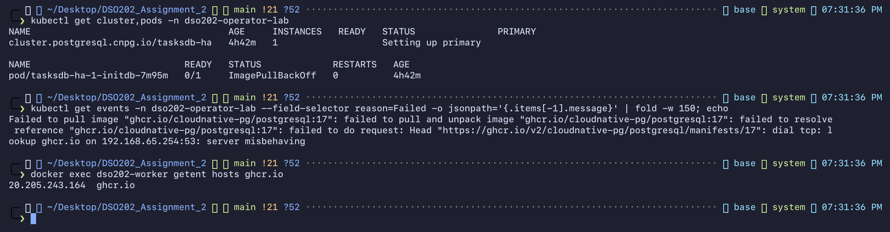
*Figure 21 — U2-17-operator-imagepull-diagnosis: ImagePullBackOff caused by a DNS failure resolving ghcr.io*

* Copying the image node-to-node (`ctr images export | ctr images import`) failed with
  `content digest … not found`: kind's containerd discards compressed layers after unpacking,
  so an unpacked image cannot be exported again.
* Running the operator on the Assignment 1 DB image via an `ImageCatalog` (major 17,
  `postgresUID/GID: 70` for Alpine) got past the PostgreSQL image, but the `initdb` Pod landed on
  `dso202-worker2`, whose init container needs the operator image, which only `dso202-worker` had.
  I abandoned it once the standard image was available, and pinned the Cluster to
  `dso202-worker` instead. A side lesson: `postgresUID` is immutable, so changing it required
  deleting and recreating the Cluster.

**What I would do differently.** Pre-load images onto the nodes (`kind load docker-image`)
before the session, as I did for the three application images; choose Gateway API or a
maintained controller instead of ingress-nginx, which entered maintenance in March 2026; and
use cert-manager instead of a manual self-signed certificate.

**Still unclear.** How CloudNativePG decides when to fence a primary that is unreachable but may
still be running (split-brain protection), and how that interacts with `failoverDelay`.
Istio (2.5) is in the descriptor but not in the supplied lecture notes, so it was not attempted.

